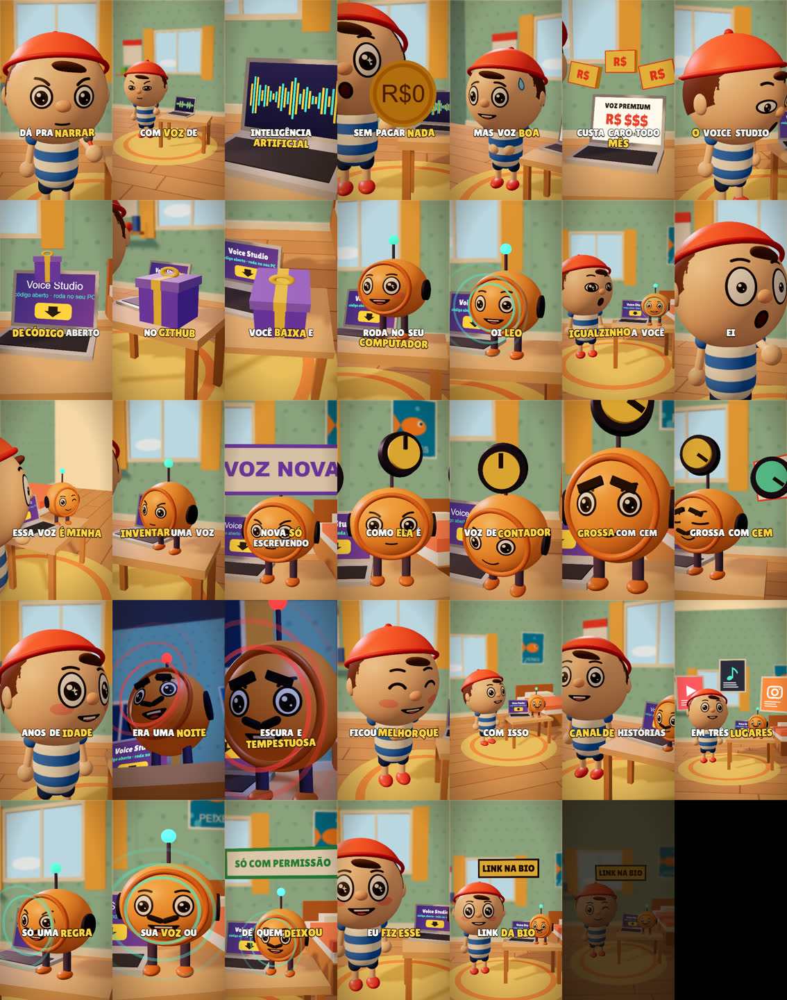

# 🎬 Shorts 3D cartoon feitos em código

Shorts verticais (1080x1920, 30 fps) em 3D cartoon, **desenhados 100% em código** com Remotion + Three.js, com **vozes neurais grátis** em português (Edge TTS) e legenda palavra por palavra.
Nenhum modelo 3D, imagem ou música baixada: personagens, cenários, rostos e efeitos sonoros são gerados pelo próprio projeto.



## Os shorts que já estão aqui
| Composition | Short | Roteiro | Código |
|---|---|---|---|
| `Short` | **Moedinha**: um menino junta moedas para comprar um peixe | [roteiro](roteiros/ROTEIRO_MOEDINHA.md) | `src/short/` |
| `Ocarina` | **O jogo da infância**: o mesmo jogo, 28 anos depois | [roteiro](roteiros/ROTEIRO_OCARINA.md) | `src/short2/` |
| `Capivara` | **A capivara balão**: comeu tanto doce que saiu voando | [roteiro](roteiros/ROTEIRO_CAPIVARA.md) | `src/short3/` |
| `Reel3D` | **A voz do Leo**: voz de IA grátis com um robô-caixa-de-som | [roteiro](roteiros/ROTEIRO_VOZ_DO_LEO.md) | `src/short4/` |

## As 6 regras do estilo
1. Cabeça enorme, corpo pequeno.
2. Luz quente e fundo desfocado.
3. Número vira objeto na palavra exata.
4. A expressão troca no meio da piscada.
5. O gesto termina antes da palavra.
6. A câmera nunca para: um enquadramento novo a cada ~1 s.

## Instalar
Você precisa de:
- **Node.js 20+**
- **Python 3.10+** com o pacote de vozes: `pip install edge-tts` (o efeito da flauta do short Ocarina também usa `numpy`)
- **ffmpeg** e **ffprobe** no PATH

```bash
npm install
```

## Gerar as vozes
O áudio não vai no repositório; ele é gerado pelos scripts (precisa de internet, as vozes vêm do Edge TTS):

```bash
python scripts/tts_short.py      # Moedinha
python scripts/tts_ocarina.py    # Ocarina
python scripts/ocarina_sfx.py    # flauta do Ocarina
python scripts/tts_capivara.py   # Capivara
python scripts/tts_reel.py       # A voz do Leo (também gera o trovão)
```

Cada script grava os MP3 em `public/audio/<short>/` e o tempo de cada palavra em `src/data/<short>-timeline.json`.

## Ver e renderizar
```bash
npx remotion studio
```

```bash
npx remotion render Reel3D out/voz-do-leo.mp4 --codec=h264 --crf=20
```

Troque `Reel3D` por `Short`, `Ocarina` ou `Capivara` para os outros.

### Folha de contato (um quadro por plano, para revisar tudo de uma vez)
```bash
node scripts/shots.mjs src/short4/shots.tsx out/reel-shots.json
```

```bash
SHOTS=out/reel-shots.json node scripts/contact.mjs Reel3D out/reel_contato.png
```

No PowerShell (Windows):
```powershell
$env:SHOTS="out/reel-shots.json"; node scripts/contact.mjs Reel3D out/reel_contato.png
```

## Fazer uma história nova
O jeito mais fácil: abra esta pasta no **Claude Code** e cole o [PROMPT_VIRAL_3D.md](PROMPT_VIRAL_3D.md). Ele guia o fluxo inteiro e para no roteiro para você aprovar.

Na mão, o fluxo é:
1. **Roteiro**: escreva `roteiros/ROTEIRO_<NOME>.md` (falas curtas, gancho nos 2 primeiros segundos, objeto para cada número).
2. **Falas**: crie `src/data/<nome>-lines.json` (`id`, `who`, `text`; `{"pause": s}` para um respiro).
3. **Vozes e tempos**: copie `scripts/tts_reel.py`, troque as vozes e os nomes, e rode. Ele gera os MP3 e o `<nome>-timeline.json`.
4. **Personagens**: reaproveite `src/kit/` (`Character`, `Robot`, `Capybara`, rostos em `Face`). Personagem novo vai num arquivo novo do kit.
5. **Planos**: copie `src/short4/` para `src/short5/` e reescreva `shots.tsx`. Cada plano tem início, fim e uma câmera que se move; amarre objetos e gestos à palavra com `W(fala, palavra)`.
6. **Composition**: adicione uma linha em `src/Root.tsx`.
7. **Folha de contato → render**, como acima.

## Estrutura
```
shorts-3d/
├── PROMPT_VIRAL_3D.md   prompt para o Claude Code criar um short novo
├── roteiros/            roteiros aprovados de cada short
├── docs/                imagens leves para este README
├── public/audio/        áudio gerado pelos scripts (fora do git, menos o "pfff" da capivara)
├── scripts/             vozes (tts_*.py), efeitos, folha de contato
└── src/
    ├── kit/             o "estúdio": rosto, personagens, robô, cenários, objetos, câmera, legenda
    ├── data/            falas (*-lines.json) e tempos de cada palavra (*-timeline.json)
    ├── short/ short2/ short3/ short4/   um short por pasta (shots.tsx = storyboard em código)
    └── Root.tsx         lista das Compositions
```

## Direitos e cuidado
- Os personagens, cenários e falas daqui são originais.
- Quando um short se inspira em vídeo de outra pessoa, ele é uma **adaptação própria da ideia**: nada de áudio, imagem, texto, nome ou marca de quem postou. O roteiro registra de onde veio a inspiração.
- O short "A voz do Leo" cita o projeto público [VoiceStudio](https://github.com/debpalash/VoiceStudio) (AGPL-3.0). Clonagem de voz: só a sua, ou de quem deixou.
- As vozes são do Edge TTS (serviço da Microsoft); confira os termos de uso antes de monetizar.
