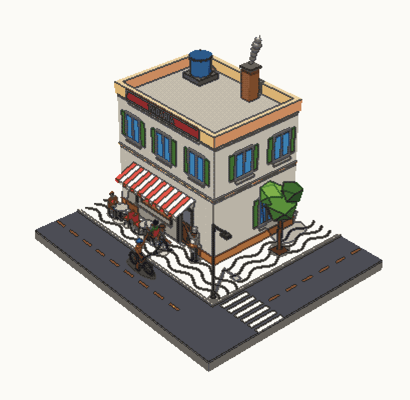

# 🏙️ Prompt Maquete: monte uma maquete 3D em pixel, só com código

Este é o prompt do short **"Mundinhos de código"**. Ele descreve **exatamente o método usado para fazer as maquetes do vídeo**: uma cena em **three.js**, desenhada 100% em código (nenhum modelo 3D baixado), com câmera de maquete, um pós-processo que transforma a imagem em pixel art (paleta fixa, contorno de tinta, pontilhado) e pessoinhas com articulação de verdade. Tudo é função do tempo `t`: o mesmo `t` gera sempre o mesmo quadro.

Funciona com qualquer agente de IA que escreva e rode código (Claude Code, por exemplo). **Testado do zero** num agente novo, que só recebeu este prompt: a padaria saiu no mesmo estilo do vídeo, com todas as cores na paleta e nenhum joelho dobrando para o lado errado. Você só precisa de um navegador e, se o agente quiser servir a página, de **Node.js** ou **Python**.



> **Créditos:** as regras de visual (câmera herói, bloco recortado, paleta, contorno, pontilhado, pessoinhas articuladas) foram adaptadas do **[Diorama](https://github.com/sloemo01/diorama)**, playbook aberto (licença MIT) de **Nehal Kanak / Sloemo01**. A implementação abaixo é nossa e mais simples. Se quiser o método completo, com processo e testes de qualidade, use o Diorama direto.

---

## O prompt (copie e cole inteiro)

```text
Monte uma maquete 3D em pixel art, só com código, numa página HTML única
(index.html) com three.js r170 via import map
(https://unpkg.com/three@0.170.0/build/three.module.js). Não baixe modelos,
texturas nem imagens: tudo é geometria primitiva (box, cylinder, sphere,
capsule, icosahedron, torus) com MeshLambertMaterial de cor sólida.
Exceções: a sombra de contato (MeshBasicMaterial preto transparente) e
os letreiros (textura de canvas gerada no próprio código).

TEMA: uma padaria de esquina brasileira, de manhã cedo.

1) TUDO É FUNÇÃO DE t
- Uma função render(t) monta o quadro a partir do tempo t (segundos).
- Nada de Math.random nem estado que passa de um quadro para o outro.
  A cena é montada só a partir de t. A cena inteira é um loop de 20 s:
  todo período de movimento divide 20 (t % 20, t % 10, t % 5...).
- Na página: um slider de t (0 a 20 s), um botão play/pause e a tecla
  espaço para pausar. O play só avança t (requestAnimationFrame).
- A página aceita ?t=SEGUNDOS na URL (abre pausada nesse tempo).

2) CÂMERA DE MAQUETE
- PerspectiveCamera com fov 20.5 (quase isométrica), azimute 45°,
  elevação 33°, mirando x = z = 0 e uma altura entre 0,2 e 2,5 m
  (ajuste até a maquete ficar centralizada na tela).
- Distância: o bloco ocupa uns 85% da largura da tela, inteiro e com
  uma pequena folga. Pode oscilar ±4° no azimute, devagar. Nada além
  disso.

3) O BLOCO RECORTADO
- Um bloco de 13 x 11 m: tampo de 4 cm na cor do piso e uma lateral cinza
  (#8f8a80) de 0,5 m por baixo, como uma maquete cortada.
- Fundo da página: papel #fbfaf6. Nada flutua fora do bloco: use 4 planos
  de recorte nas bordas, para que um ciclista ou ônibus entrando apareça
  cortado na borda. Use planos locais nos materiais (clippingPlanes com
  clipShadows: true), para que o que está fora também não projete
  sombra dentro do bloco.

4) LUZ E SOMBRA
- HemisphereLight (céu #e9f1ff, chão #b59a7a, 1.6) + DirectionalLight
  (#fff1dc, 2.6) vindo de cima, com sombra (shadow map 2048, PCF,
  câmera de sombra cobrindo o bloco).
- Pessoas, mesas, cadeiras, bicicleta e poste ganham uma "sombra de
  contato": um círculo preto com 28% de opacidade logo abaixo, no chão.

5) PÓS-PROCESSO PIXEL (o segredo do visual)
- Renderize a cena num WebGLRenderTarget com METADE da resolução da
  tela (HalfFloat, filtro Nearest, fundo transparente).
- Desenhe esse alvo na tela com um quad e um ShaderMaterial que, para
  cada pixel do alvo (use floor(uv * resolução) para todos os pixels
  ampliados ficarem iguais):
  a) gama: c = pow(c, 1/2.2);
  b) grade: saturação 1.07 e contraste 1.028 (antes do snap);
  c) contorno de tinta: maior diferença de luma entre o pixel e os 4
     vizinhos (só vizinhos com alfa > 0.5), edge = pow(dif, 0.4545),
     tinta = smoothstep(0.13, 0.34, edge); misture 62% em direção a
     #16151a (quase preto, a última cor da linha de cinzas da paleta);
  d) pontilhado Bayer 8x8, bem fraco no plano e mais forte onde o tom
     muda:
     c += (bayer8 - 0.5) * (0.012 + 0.03 * smoothstep(0.004, 0.055, edge));
  e) snap na paleta: troque a cor pela entrada mais próxima da paleta
     abaixo, com peso (1.0, 1.12, 0.93) nos canais RGB;
  f) recorte sobre o papel: alfa < 0.03 vira papel, alfa > 0.97 é cena,
     e no meio a borda é pontilhada pelo Bayer.
- No canvas, use CSS image-rendering: pixelated.
- PALETA (47 cores, valores sRGB, comparar já no espaço de exibição):
  #fbfaf6 #efece4 #d9d4c8 #b9b3a6 #8f8a80 #66625c #45423e #2b2926 #16151a
  #4c4d55 #5f616a #787a83 #c9c1b0 #e2dac8
  #f3e6c8 #e8cf9c #d9b273 #c98f4f #a86a3a #7a4a2a #55331f
  #e5554a #c23b35 #8e2a2b #f08a4b #f7b267 #ffd65a #f2c14e
  #a9cf6a #7fb04a #5a8f3a #3e6b2f #2a4a25 #9fd3a8
  #bfe3ee #8fc9dc #5aa9c9 #3b7fb0 #2c5a8a #1f3b63
  #f6d2b0 #e9b48c #c98a5e #8d5a3b #5c3a26 #d98bb0 #9b6bb0

6) PESSOINHAS COM ARTICULAÇÃO DE VERDADE
- Figura de 1,69 m, olhando para +Z, montada com um Group por junta.
  Nos braços e pernas, a geometria fica pendurada para baixo (-Y) a
  partir da junta; tronco, pescoço e cabeça sobem (+Y). Medidas (a partir
  do chão, com a pelve em 0,86 m):
  pelve 0,86; quadris a ±0,10 da linha central; coxa 0,42; canela 0,40;
  pé (caixa 0,10 x 0,07 x 0,24, apontando para +Z);
  tronco: cilindro afinando para baixo (raio 0,20 em cima, 0,15 embaixo),
  0,46 de altura, achatado 0,72 em Z, começando 0,10 acima da pelve;
  ombros a ±0,20 da linha central e 0,49 acima da pelve (1,35 do chão);
  braço 0,30; antebraço 0,27; mão (esfera 0,05);
  pescoço 0,58 acima da pelve; centro da cabeça 0,15 acima do pescoço
  (esfera 0,125), com cabelo, olhos, nariz e orelhas.
- Membros são cápsulas e TODA junta tem uma esfera de enchimento, para a
  dobra nunca abrir um buraco.
- Sinais (acerte uma vez): quadril X positivo joga a coxa para trás;
  joelho X positivo dobra o calcanhar para trás (negativo parece perna
  quebrada); ombro X positivo joga o braço para trás; cotovelo X negativo
  dobra o antebraço para a frente.
- Poses como funções de uma fase: andar (quadris opostos ±0,5 rad,
  joelho que só dobra para trás, braços opostos às pernas, leve
  balanço), sentar (quadril -1,45, joelho +1,45), acenar (ombro
  levantado, cotovelo balançando), pedalar e segurar bandeja.
- Andar por um caminho: posição e rumo calculados a partir de t ao longo
  de uma lista de pontos.
- Variações de roupa: padeiro (avental e touca), clientes com camisetas
  de cores diferentes, um ciclista de capacete.

7) A CENA: PADARIA DE ESQUINA
- Esquina: uma rua na frente e outra na lateral (asfalto #4c4d55, faixas
  amarelas tracejadas), meio-fio, faixa de pedestre e calçada de pedra
  portuguesa (ondas escuras sobre piso claro).
- Prédio de 2 andares creme com platibanda, porta de madeira que abre,
  vitrine com 9 pães (cápsulas douradas), toldo listrado vermelho e
  branco, letreiro "PADARIA" grande na platibanda (textura de canvas,
  letras de no mínimo 0,6 m de altura, para não virar ruído no pixel), placa
  pendurada "ABERTO/FECHADO" que vira, janelas no andar de cima, caixa
  d'água e chaminé do forno soltando vapor.
- Calçada: duas mesinhas de metal com cadeiras vermelhas, um café com
  vapor na mesa, poste de luz e uma árvore (tronco + 3 blocos de copa
  facetados).
- Gente: o padeiro na porta acenando; dois clientes sentados (um toma
  café de tempos em tempos); uma cliente andando pela calçada até a porta
  e voltando; um ciclista que chega pela rua, para em frente à padaria,
  apoia um pé no chão, acena e vai embora (cortado nas bordas do bloco).
- Vapor: esferas brancas que sobem, crescem e somem, em loop.

8) ENTREGA E VERIFICAÇÃO
- Rode a página e tire prints em t = 0, 3, 6, 9 e 12 s. Confira em cada
  um: o bloco inteiro aparece, as pessoinhas estão de pé sobre o piso
  (pés no chão, sem flutuar nem afundar; o ciclista pedalando é a
  exceção), joelhos dobrando para o lado certo, nada fora do bloco, e
  todas as cores são da paleta (dá para conferir lendo os pixels do
  canvas).
- Me diga o que cada print prova e o que você ajustaria.
```

**Troque a padaria** pelo que você quiser e mantenha o resto do pedido. As outras maquetes do vídeo:
- **Praça:** gramado, caminhos em cruz e em anel, coreto octogonal de telhado vermelho, bancos, árvores, carrinho de pipoca com vapor, gente andando em volta e pombos.
- **Ponto de ônibus:** rua no fundo, abrigo com banco, placa "ÔNIBUS", canteiro com flores, e um ônibus que chega, para, abre a porta, a fila sobe e ele vai embora.
- **Banca de jornal:** banca verde com revistas coloridas na frente, jornaleiro, um senhor que chega e para para ler o jornal, carro estacionado e vasos.

Dica: descreva **ações** ("o ônibus chega e a fila sobe"), não só o lugar. É o movimento que deixa a maquete viva.

---

## Do jeito que fizemos no vídeo (opcional)

No short, a mesma maquete roda dentro do **Remotion** (React Three Fiber via `@remotion/three`), com o tempo vindo do quadro do vídeo (`t = frame / 30`). Assim cada quadro do vídeo é exatamente a cena em `t`. Para pedir assim, acrescente ao final do prompt:

```text
Em vez de uma página HTML, faça a maquete como componente React Three
Fiber dentro de um projeto Remotion (1080x1920, 30 fps), usando
<ThreeCanvas> do @remotion/three e t = useCurrentFrame() / 30. O
pós-processo é um componente com useFrame(..., 1) que renderiza a cena
no alvo de meia resolução e depois desenha o quad do shader na tela.
```

O pipeline completo para virar short (roteiro, vozes neurais grátis em PT-BR, legenda palavra por palavra e render) está em [`PROMPT_VIRAL_3D.md`](../../PROMPT_VIRAL_3D.md) e no [`README.md`](../../README.md).

---

## Créditos e licença
- Regras de visual adaptadas do **Diorama** © 2026 Nehal Kanak / Sloemo01, licença MIT: https://github.com/sloemo01/diorama
- Este guia, o prompt e as maquetes do vídeo são deste repositório. Não somos afiliados ao autor do Diorama.
